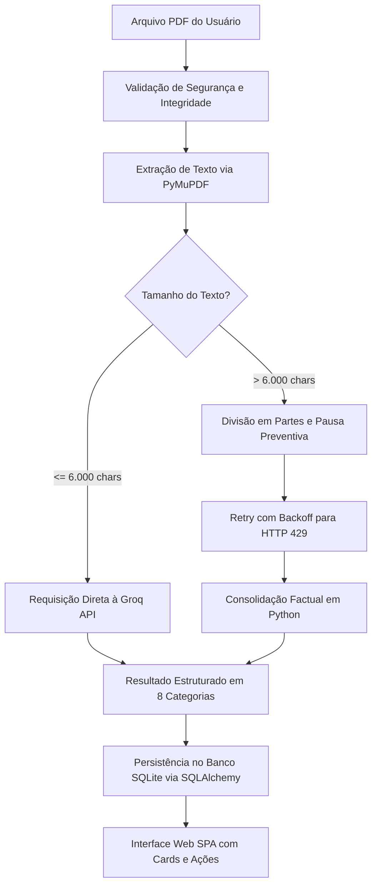
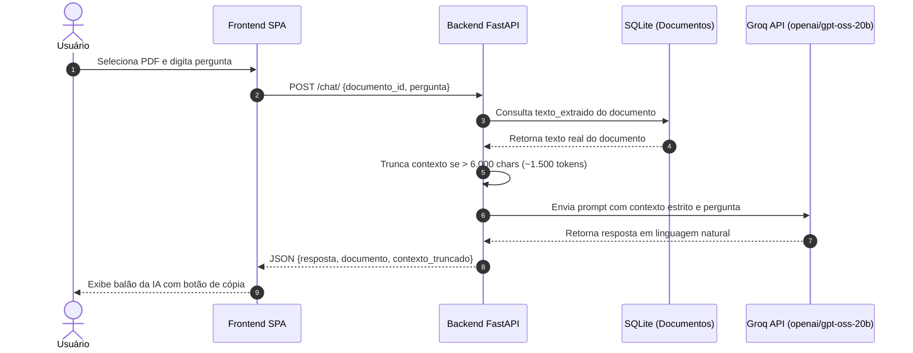

# HEMADA — Plataforma de Inteligência Documental com IA

> **Trabalho de Conclusão de Curso (TCC)**  
> **Curso:** Análise e Desenvolvimento de Sistemas (ADS) — SENAI  
> **Integrantes:** Mario Oliveira, Henrique Smomcovitz, Davi Joaquim  
> **Versão:** 1.0 Estável (Release Final)

---

## 1. Visão Geral do Projeto

O **HEMADA** é uma plataforma web para análise, extração e interpretação inteligente de documentos não estruturados em formato PDF. Combinando **processamento de linguagem natural (PLN)**, **inteligência artificial generativa de alta velocidade (Groq API)** e **extração nativa de texto (PyMuPDF)**, o sistema automatiza rotinas de backoffice e transforma documentos complexos em informações estruturadas e consultáveis em tempo real.

O sistema foi concebido para resolver o problema enfrentado por empresas que lidam com grandes volumes diários de contratos, relatórios técnicos, editais e termos de compromisso, nos quais a leitura manual consome horas de trabalho humano e é suscetível a falhas de atenção.

---

## 2. As 8 Categorias da Análise Documental

Ao processar qualquer documento PDF, o motor cognitivo do HEMADA extrai e estrutura estritamente os fatos nas seguintes 8 categorias:

| # | Categoria | Descrição |
|---|---|---|
| **1** | **Resumo Geral** | Síntese executiva e objetiva do conteúdo essencial do documento. |
| **2** | **Assunto Principal** | Definição clara do tema central ou finalidade jurídica/operacional. |
| **3** | **Informações Importantes** | Cláusulas de destaque, obrigações das partes e condições fundamentais. |
| **4** | **Datas Identificadas** | Prazos de vigência, datas de assinatura, marcos de entrega e vencimentos. |
| **5** | **Valores Monetários** | Cifras contratuais, parcelas, multas, taxas e remunerações. |
| **6** | **Pessoas e Empresas** | Partes contratantes, testemunhas, empresas parceiras e representantes legais. |
| **7** | **Pendências** | Obrigações ainda não cumpridas, laudos pendentes ou exigências a vencer. |
| **8** | **Pontos de Atenção** | Alertas de risco, cláusulas de rescisão antecipada e multas rescisórias. |

---

## 3. Arquitetura do Sistema e Fluxo de Dados

A plataforma foi arquitetada sob o modelo **FastAPI + SQLite + SPA Vanilla**, priorizando código simples, limpo e direto, sem camadas desnecessárias de abstração.

### Diagrama de Fluxo: Processamento Documental



### Diagrama de Fluxo: Assistente de IA (Chat Contextualizado)



---

## 4. Tecnologias Utilizadas

- **Linguagem:** Python 3.12+
- **Framework Web Backend:** [FastAPI](https://fastapi.tiangolo.com/) com [Uvicorn](https://www.uvicorn.org/)
- **Extração de Texto:** [PyMuPDF](https://pymupdf.readthedocs.io/) (`fitz`) — alta velocidade e extração de páginas completas
- **Inteligência Artificial:** [Groq API](https://groq.com/) utilizando o modelo `openai/gpt-oss-20b` (recomendação oficial da Groq)
- **Banco de Dados Relacional:** SQLite 3 integrado com [SQLAlchemy ORM](https://www.sqlalchemy.org/)
- **Frontend:** Single-Page Application (SPA) em HTML5, CSS3 moderno (Custom Properties, Flexbox, Grid) e JavaScript puro (ES6+) sem frameworks externos pesados

---

## 5. Estrutura de Diretórios

```
Automatizacao_BackOficce/
├── app/
│   ├── __init__.py
│   ├── database.py           # Conexão SQLAlchemy e inicialização do SQLite
│   ├── main.py               # Instância FastAPI, rotas e montagem de estáticos
│   ├── model/
│   │   └── documento.py      # Modelo ORM da tabela de documentos
│   └── route/
│       ├── __init__.py
│       ├── chat.py           # Rota POST /chat/ com controle de TPM e erros
│       ├── historico.py      # Rotas GET /historico/ e /limpar-historico/
│       └── upload.py         # Rota POST /uploads/ com PyMuPDF, chunks e Groq
├── data/
│   └── banco.db              # Banco de dados SQLite persistente
├── static/
│   ├── index.html            # Estrutura SPA com 4 telas (Dashboard, Upload, Histórico, Chat)
│   ├── style.css             # Design System moderno, responsivo e minimalista
│   └── script.js             # Lógica cliente, comunicação com endpoints e modais
├── tests/
│   ├── test_chat.py          # 23 testes unitários do chat e erros da Groq
│   ├── test_groq_real.py     # Testes de integração real com a API Groq
│   ├── test_inteligencia_documental.py # 21 testes de extração, validação e chunks
│   └── test_rotas_app.py     # 4 testes de integridade das rotas do FastAPI
├── .env.example              # Exemplo de configuração de variáveis
├── requirements.txt          # Dependências do projeto Python
└── README.md                 # Documentação completa do projeto
```

---

## 6. Instalação e Execução (Windows / PowerShell)

### Passo 1: Clonar ou abrir a pasta do projeto

```powershell
cd C:\Users\AlunoADS2\Automatizacao_BackOficce
```

### Passo 2: Criar e ativar o ambiente virtual Python

```powershell
# Criação do ambiente virtual (caso não exista)
python -m venv .venv

# Ativação no PowerShell
.\.venv\Scripts\Activate.ps1
```

> **Dica de permissão:** Se o PowerShell bloquear a execução de scripts, execute uma vez como Administrador:  
> `Set-ExecutionPolicy -ExecutionPolicy RemoteSigned -Scope CurrentUser`

### Passo 3: Instalar as dependências

```powershell
pip install -r requirements.txt
```

### Passo 4: Configurar as variáveis de ambiente

Crie o arquivo `.env` na raiz do projeto a partir do modelo:

```powershell
Copy-Item .env.example .env
```

Edite o arquivo `.env` e insira sua chave de API da Groq:

```env
API_KEY=gsk_sua_chave_real_aqui
GROQ_MODEL=openai/gpt-oss-20b
```

### Passo 5: Iniciar o servidor

```powershell
.\.venv\Scripts\uvicorn.exe app.main:app --reload --host 127.0.0.1 --port 8000
```

Acesse no navegador:
- **Plataforma Web HEMADA:** [http://127.0.0.1:8000](http://127.0.0.1:8000)
- **Documentação Interativa Swagger:** [http://127.0.0.1:8000/docs](http://127.0.0.1:8000/docs)
- **Healthcheck:** [http://127.0.0.1:8000/health](http://127.0.0.1:8000/health)

---

## 7. Execução dos Testes Automatizados

A suíte possui **50 testes automatizados**, cobrindo validações de segurança, tratamento de limites de taxa (TPM), simulações de erro da Groq e rotas do sistema.

Para executar todos os testes:

```powershell
.\.venv\Scripts\python.exe -m unittest discover -s tests -p "test_*.py" -v
```

**Resultado esperado:**
```
Ran 50 tests in ~0.10s
OK (skipped=2)
```
*(Os 2 testes de integração real em `test_groq_real.py` são automaticamente ignorados quando o ambiente de execução não dispõe de conexão com a internet externa).*

---

## 8. Tratamento de Limites, Resiliência e Confiabilidade

1. **Documentos Extensos e Limite de TPM (Tokens por Minuto):**
   - Documentos com mais de 6.000 caracteres são fragmentados respeitando quebras de parágrafos.
   - O sistema realiza pausas preventivas entre lotes e implementa retry exponencial automático para erros `HTTP 429`.
2. **Truncamento Conservador no Chat e Gestão de TPM:**
   - O texto do documento selecionado é truncado em até 6.000 caracteres (~1.500 tokens de entrada). Essa medida visa manter o consumo de tokens em patamar moderado para diminuir o risco de exaustão da cota por minuto da conta.
   - O truncamento não garante imunidade contra rate limit em contas com cotas restritas ou chamadas concorrentes; por isso, a aplicação trata explicitamente o código `HTTP 429`, lendo cabeçalhos de espera (`retry-after`) para instruir o usuário de forma clara.
3. **Ancoragem Factual (Grounding) e Mitigação de Alucinações:**
   - A injeção do conteúdo documental no prompt estabelece uma base de fundamentação para as respostas do modelo, direcionando a síntese para as informações verificáveis do texto.
   - **Nota técnica de confiabilidade:** Embora a ancoragem factual reduza substancialmente o risco de invenção de dados, modelos de linguagem generativos permanecem sujeitos a interpretações divergentes ou erros sutis. A plataforma não deve ser considerada à prova de falhas, recomendando-se sempre a conferência humana de pontos jurídicos e financeiros críticos.
4. **Segurança de Credenciais:**
   - Chaves de API (`gsk_...`) nunca são expostas no front-end e são sanitizadas de todas as mensagens de erro antes de serem retornadas ao cliente.

---

## 9. Licença e Direitos

Projeto desenvolvido como requisito parcial para obtenção do título de Técnico em Análise e Desenvolvimento de Sistemas pelo SENAI.  
Uso livre para fins educacionais e de demonstração acadêmica.
